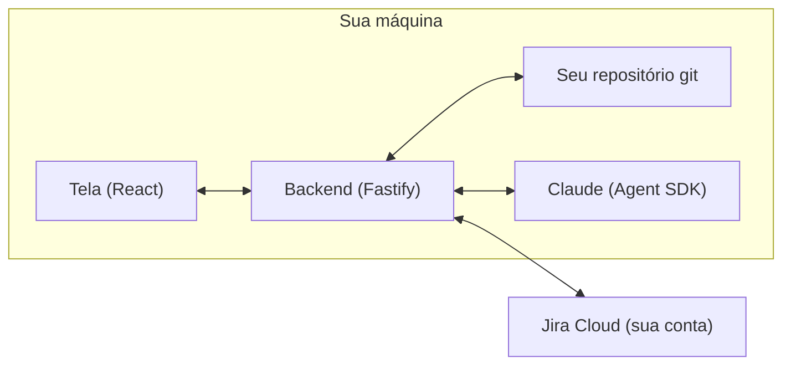
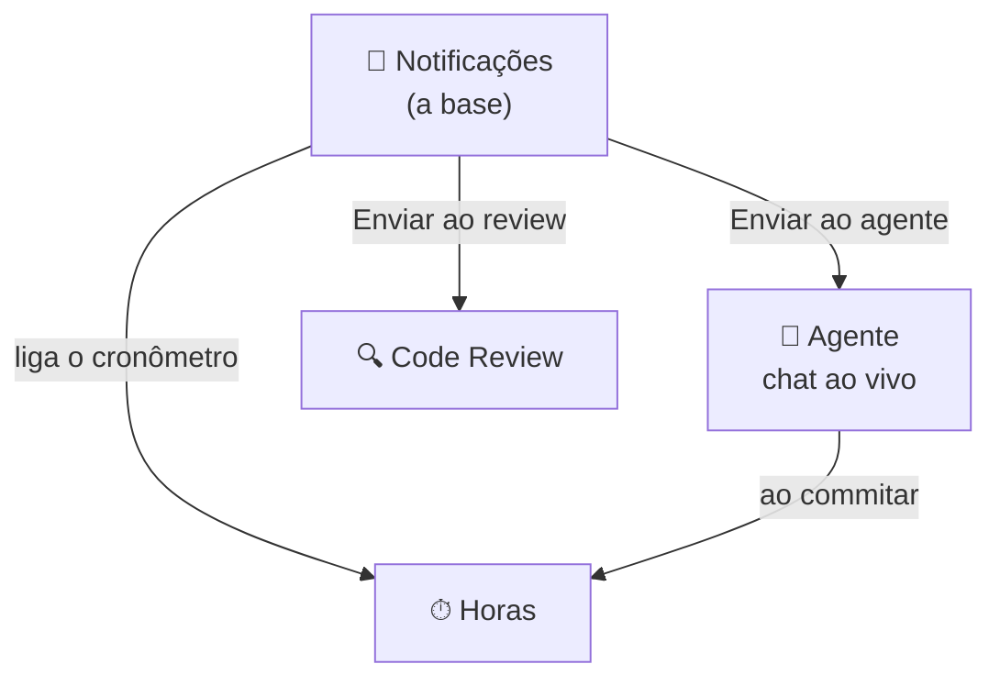
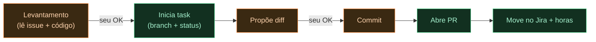

<p align="center">
  
</p>

<p align="center">
  
  
  
  
  
</p>

> Ferramenta local que reúne, numa tela só, as notificações do Jira, o controle de horas, um agente de desenvolvimento com IA e o code review. Cada ação que mexe em código passa pela sua aprovação.

---

## O que é

O **jira-dev-agent** é uma ferramenta **local** (roda na sua máquina) que junta num lugar só o que hoje fica espalhado no dia de um desenvolvedor:

- **Notificações** do Jira (status, comentários, responsável, novas issues) — e quem fez cada mudança.
- **Timesheet automático** — conta as horas pela branch do git e lança no Jira ao commitar.
- **Agente de desenvolvimento** — um chat ao vivo com IA (via Claude) que lê o código, propõe mudanças e **pede sua permissão antes de mexer em qualquer coisa**.
- **Code Review** — um agente que revisa o *Change Set* (sua branch × a base) e aponta os problemas.

Tudo começa na aba **Notificações**: de uma notificação você "Envia ao agente" ou "ao review", e isso já liga o cronômetro e abre a task na aba certa.

## Por que foi feito

No corre do dia a dia, o desenvolvedor fica **saltando entre ferramentas**: o Jira num lugar, o código no editor, o cronômetro na cabeça, o Claude no terminal, o GitHub no navegador. Cada troca de contexto custa tempo e atenção.

E tem o outro lado: a maioria dos "agentes de IA" faz **tudo sozinho** e te mostra o resultado no fim — você perde o controle e a visibilidade. Aqui a filosofia é o oposto: **a IA expõe o que está fazendo e espera o seu OK**. A interação representa o **seu controle** + a **capacidade dela de comunicar**.

## O que melhora

| Antes | Com o jira-dev-agent |
|---|---|
| Ficar atualizando o Jira pra ver o que mudou | Feed que avisa (e diz **quem** fez) |
| Anotar horas na mão / esquecer de lançar | Horas contadas pela branch e lançadas no commit |
| Copiar a descrição da task pro Claude no terminal | "Enviar ao agente" já leva o contexto da issue |
| Agente que faz tudo sozinho | Agente que **propõe e espera seu OK** (portões) |
| Revisar PR na mão | Agente de Code Review sobre o Change Set |

---

## Como funciona

A ferramenta é um **cockpit local**: um backend (Node/TypeScript) que fala com o seu Jira, o seu git e a IA, e uma tela (React) onde tudo acontece.



### As quatro abas (Notificações é a base)



### O agente com portões

Nada que mexe em código acontece sem você. Trabalho mecânico de git/Jira é automático; **código pede seu OK**.




## Como clonar e usar (em qualquer máquina)

> Pré-requisitos: **git**, **nvm** (gerenciador de versões do Node) e uma conta no **Jira Cloud**. Para a parte de IA, uma assinatura do **Claude** (Pro/Max/Team/Enterprise).

### 1. Clonar e entrar na pasta
```sh
git clone https://github.com/RonaldoCDRinaldiDev/jira-dev-agent.git
cd jira-dev-agent
```

### 2. Node 22 (sem mexer no Node dos seus outros projetos)
```sh
nvm install 22
nvm use 22
```
> Não tem nvm? Instale em https://github.com/nvm-sh/nvm. Ele deixa várias versões de Node convivendo — seus outros projetos continuam na versão deles.

### 3. Instalar dependências (backend e tela)
```sh
npm install
npm --prefix web install
```

### 4. Configurar o `.env`
```sh
cp .env.example .env
```
Abra o `.env` e preencha (veja a seção **Configuração** abaixo). No mínimo: `JIRA_BASE_URL`, `JIRA_EMAIL`, `JIRA_API_TOKEN`.

### 5. Ligar a IA (opcional, só pro agente)
```sh
npm install -g @anthropic-ai/claude-code
claude setup-token
```
Cole o token gerado na linha `CLAUDE_CODE_OAUTH_TOKEN=` do `.env`.

### 6. Rodar
```sh
npm start
```
Abra **http://127.0.0.1:7788** no navegador. Pronto. 🎉

> `npm start` monta a tela e sobe o servidor juntos, numa porta só. Para desenvolver com recarga automática, rode o backend (`npm run dev`) e a tela (`npm --prefix web run dev`) em dois terminais.

---

## Configuração (`.env`)

| Variável | Para quê |
|---|---|
| `JIRA_BASE_URL` | URL do seu Jira (ex.: `https://suaempresa.atlassian.net`) |
| `JIRA_EMAIL` | seu e-mail Atlassian |
| `JIRA_API_TOKEN` | token do Jira (Atlassian → Security → API tokens) |
| `JIRA_JQL` | o que acompanhar (padrão: suas tasks) |
| `CLAUDE_CODE_OAUTH_TOKEN` | token do `claude setup-token` (habilita o agente) |
| `TIMESHEET_REPOS` | caminhos dos seus repos locais, separados por vírgula (habilita o timesheet) |
| `AUTO_LOG_ON_COMMIT` | `1` lança as horas no Jira ao commitar |
| `PORT` | porta do app (padrão `7788`) |

Você também pode conectar o Jira pela **tela** (botão *Conexão*), sem editar arquivo.

## Instruções do agente (`AGENT.md`)

O arquivo **`AGENT.md`** na raiz guia como o agente age e se comunica — incluindo o padrão **Feito / Falta / Status** e a sequência de fechamento de uma task. Edite à vontade (pela tela, botão *Instruções*, ou direto no arquivo). O `CLAUDE.md` de cada repositório também é respeitado.

## Privacidade

Tudo roda **na sua máquina**. As credenciais ficam no seu `.env` local (fora do git). Os dados coletados ficam em `./data/` (também fora do git). Nada é enviado para servidores de terceiros além do seu próprio Jira e da API do Claude (quando você usa o agente).

## Stack

**Backend:** Node 22, TypeScript, Fastify, Zod · **Frontend:** React 18, Vite, React Query, Framer Motion · **IA:** Claude Agent SDK · **Integrações:** Jira REST API, git, GitHub CLI (`gh`).

