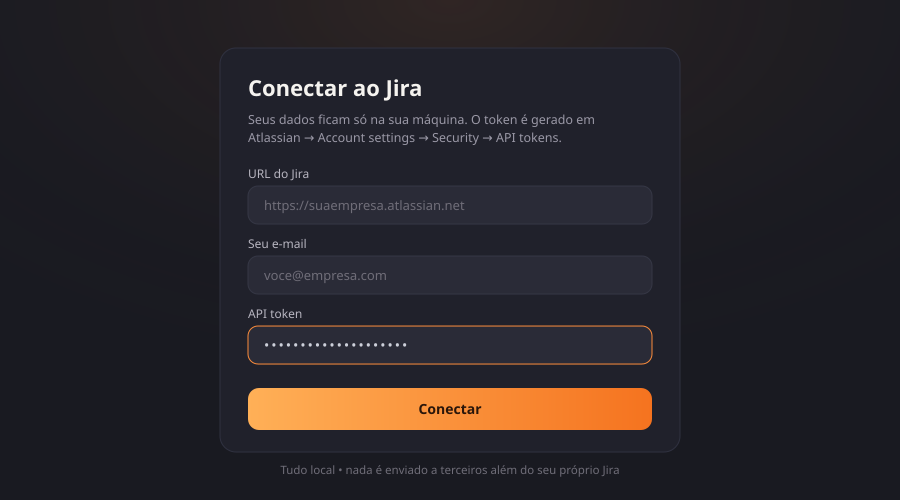
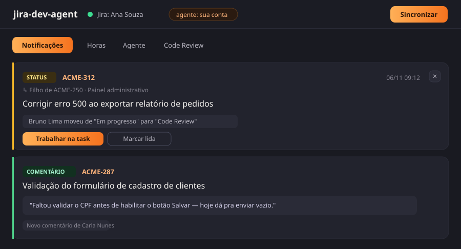
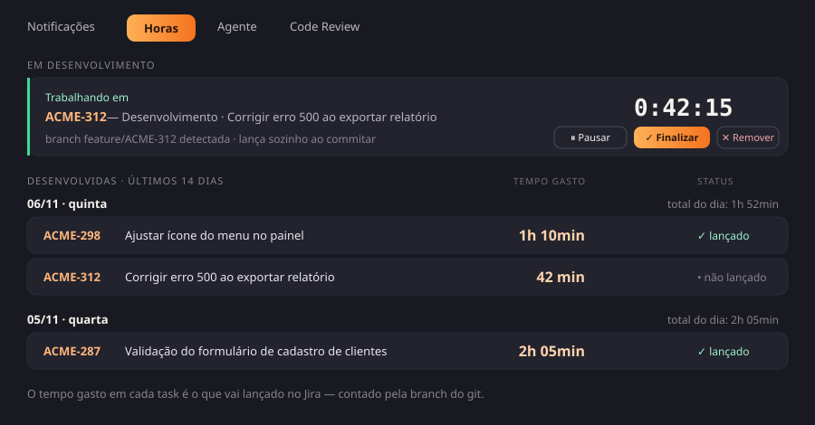
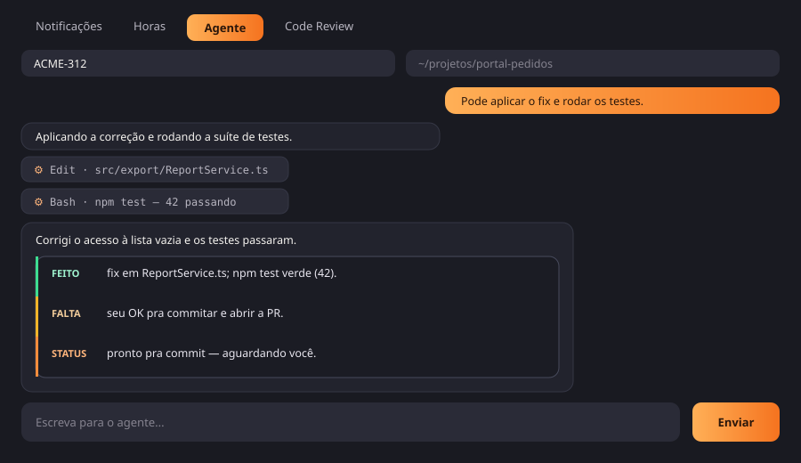
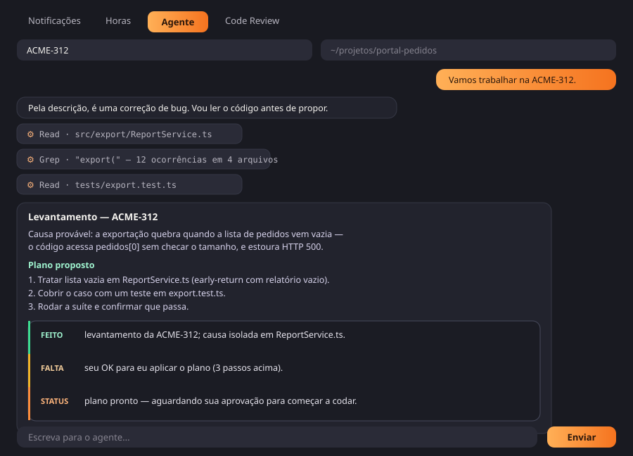
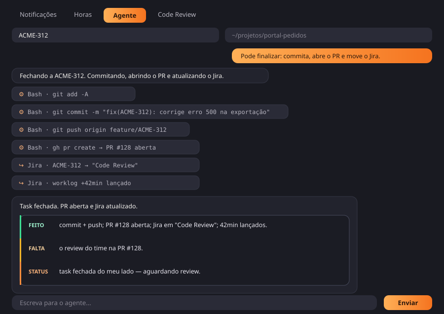
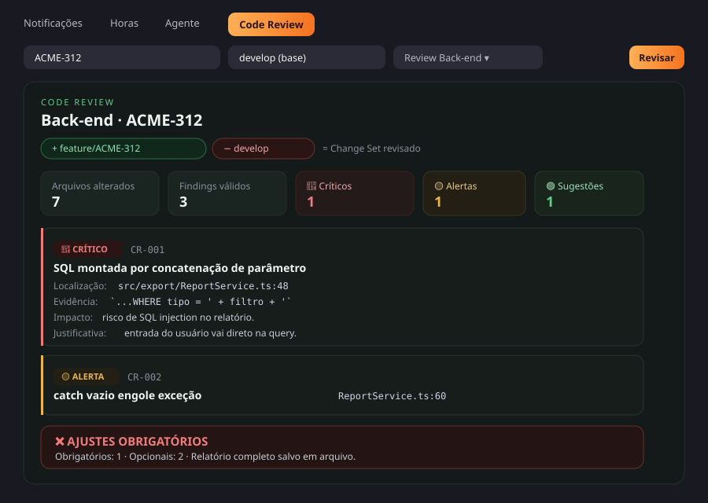
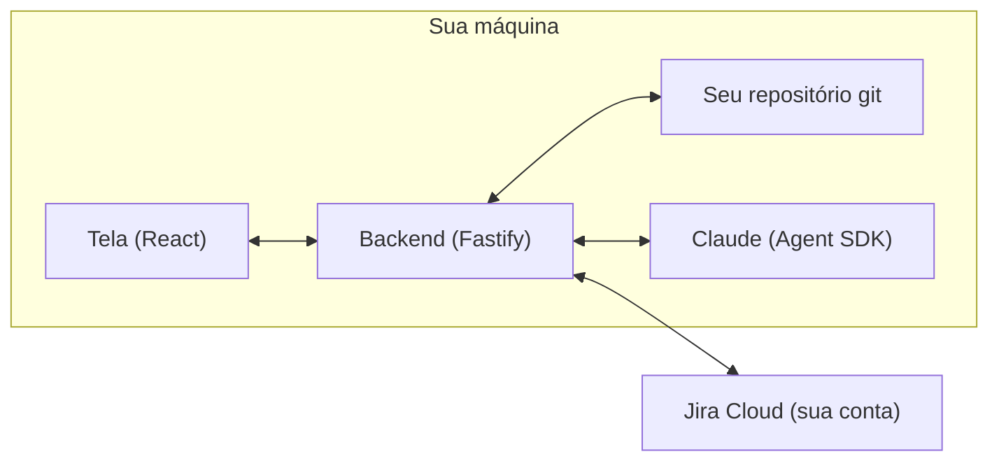
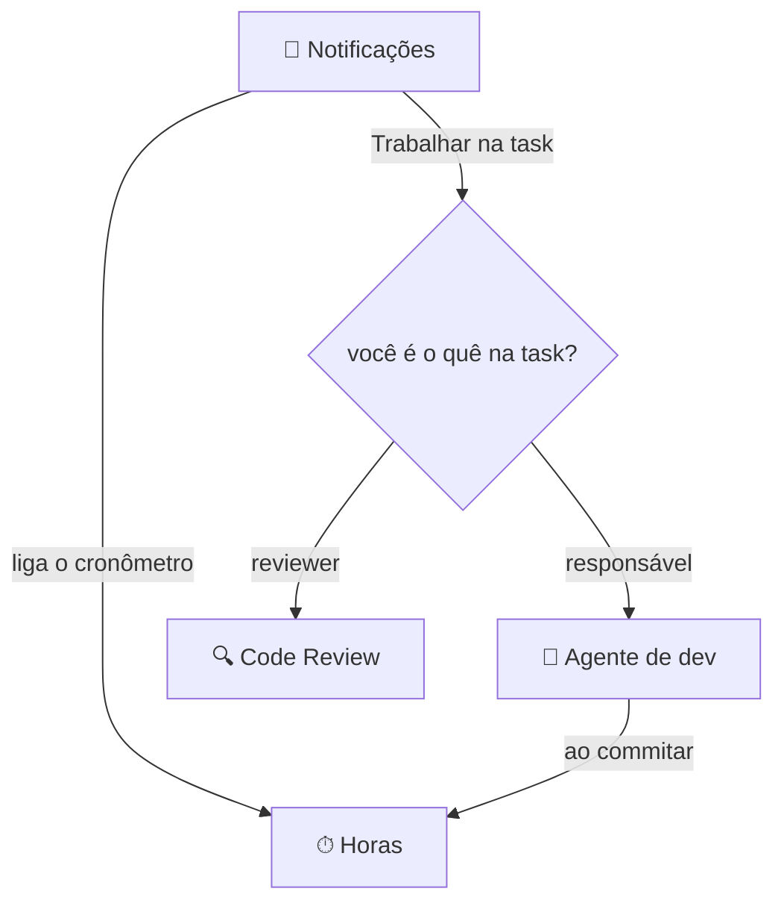
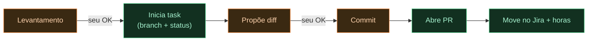

<p align="center">
  
</p>

<p align="center">
  
  
  
  
  
</p>

> Ferramenta **local** que reúne, numa tela só, as notificações do Jira, o controle de horas, um agente de desenvolvimento com IA e o code review. Cada ação que mexe em código passa pela sua aprovação.

> As imagens abaixo usam **dados fictícios** (projeto `ACME`, pessoas e tasks inventadas) só para ilustrar o uso.

---

## O que é e por que

No dia a dia o desenvolvedor fica **pulando entre ferramentas**: Jira, editor, cronômetro, IA no terminal, GitHub no navegador. Cada troca custa tempo e atenção.

O **jira-dev-agent** junta tudo num **cockpit local**. E, ao contrário da maioria dos agentes de IA que fazem tudo sozinhos, aqui a regra é o **seu controle**: a IA mostra o que está fazendo e **espera o seu OK** antes de qualquer alteração.

---

## O fluxo completo — da notificação ao PR

Tudo começa na aba **Notificações**. A partir de um aviso, uma coisa puxa a outra — e você só precisa aprovar o que mexe em código. Passo a passo:

1. **Chega uma mudança no Jira** (novo status, um comentário, uma task nova) e ela aparece no feed.
2. Você clica em **Trabalhar na task** — um botão só. O app **olha a task e decide sozinho** o destino: se _você_ é o **reviewer**, vai pro **Code Review**; se é o **responsável**, vai pro **agente de dev**. Em ambos os casos o **cronômetro liga** (aba Horas) e a aba certa abre já com o contexto da issue.
3. **Se foi pro dev**, no **chat** o agente faz o levantamento, te explica o plano e **vai codando — mas pede sua permissão antes de cada alteração**. Você acompanha tudo em tempo real, e a cada resposta ele fecha com um resumo **Feito / Falta / Status**, então você nunca fica perdido.
4. Quando o trabalho está pronto, você manda **finalizar**. O agente **pede uma última confirmação** e, com o seu "sim", fecha a task de ponta a ponta sem você precisar fazer nada manual:
   - **commita** as mudanças aprovadas,
   - **abre o Pull Request**,
   - **move a task no Jira**,
   - **comenta a resolução** na própria issue,
   - e **lança as horas** trabalhadas no Jira.
5. **Se foi pro Code Review**, o agente lê o _Change Set_ (sua branch × a branch base), roda as checagens e te dá um **veredito**. Dali você **Aprova + mergeia** (aprova/mergeia a PR, move pra _Pending Deploy_, comenta que passou e lança as horas do review) ou **Reprova a task** (move pra _Fail_ e comenta o motivo detalhado). As horas do review também são lançadas.

Resumindo: **você decide, o agente faz o trabalho chato e te mostra cada passo** — da primeira notificação até o PR aberto e as horas lançadas, sem sair desta tela.

> **Por que não é 100% automático?** Tecnicamente, dá para deixar esse agente totalmente autônomo — ele recebe a notificação, desenvolve, commita, abre o PR e fecha a task sozinho, sem ninguém no meio. **Foi uma decisão não fazer assim (ainda).** A proposta aqui é _aumentar a produtividade sem abrir mão do controle_: a IA faz o trabalho pesado, mas quem mexe em código só avança com o seu OK, e você revisa cada etapa. Isso evita erros passando direto e mantém você no comando. A automação total fica como um próximo passo possível — ligável quando a confiança no fluxo estiver madura.

---

## Funcionalidades

### 🔌 Conexão — o login (tudo local)

Na primeira vez que você abre o app, cai direto nesta tela. É o "login" da ferramenta: você conecta o **seu** Jira informando três coisas — a **URL** do seu Jira Cloud (`https://suaempresa.atlassian.net`), o seu **e-mail** Atlassian e um **API token**.



Como funciona, em resumo:

- **O API token** é gerado por você em _Atlassian → Account settings → Security → Create API token_. Ele substitui a senha e você pode revogá-lo quando quiser. Cole no campo e clique em **Conectar** — o app valida a credencial no seu Jira na hora e, se der certo, já carrega o feed.
- **Tudo fica na sua máquina.** As credenciais são salvas localmente (em `./data/`, fora do git) e nunca são enviadas a terceiros — só ao seu próprio Jira. Nada de servidor no meio.
- **Dá pra reabrir quando quiser** pelo botão **Conexão** no topo (por exemplo, pra trocar de conta ou atualizar o token). Também dá pra configurar por arquivo, preenchendo o `.env` em vez da tela.
- **A IA do agente usa um token à parte** (o do seu Claude), gerado uma vez com `claude setup-token` e colado no `.env` — ele não entra nesta tela porque não é uma credencial do Jira. Sem ele, o app funciona normalmente; só o chat do agente fica desligado.

### 🔔 Notificações — a base de tudo

O feed do seu Jira em tempo real: mudanças de status, comentários, troca de responsável e novas issues — mostrando **quem fez** cada coisa e o **épico/pai** da task. É daqui que tudo parte: em cada item você clica em **Trabalhar na task** e o app decide sozinho o destino — **reviewer = você → Code Review**, **responsável = você → agente de dev** —, já ligando o cronômetro. Também dá pra **excluir** um item do feed.



### ⏱ Horas — timesheet automático

Conta o tempo de trabalho **pela branch do git** (ex.: `feature/ACME-312`), descontando ociosidade. Você inicia/para a sessão, e ao **commitar** na branch da task as horas são **lançadas no Jira** sozinhas.



### 🤖 Agente de desenvolvimento

Uma conversa ao vivo, como no Claude Code, só que nesta tela: o agente **lê o código**, mostra **o que está fazendo** (arquivos que lê, comandos que roda), explica o plano e **pede sua permissão antes de editar ou commitar**. Ele responde no padrão **Feito / Falta / Status** e segue o `AGENT.md` + o `CLAUDE.md` do repositório.



No começo da task, o agente faz um **levantamento detalhado** — lê o código envolvido (sem alterar nada), aponta a causa e propõe um plano objetivo, e só começa a codar depois do seu OK:



Na hora de fechar, você manda o agente **finalizar** e ele executa tudo no chat — commit, push, abre o PR, move a task no Jira e lança as horas — terminando com o resumo **Feito / Falta / Status**:



### 🔍 Code Review — revisão automática

Um agente **read-only** que revisa o _Change Set_ (sua branch × a branch base), roda as skills de revisão (segurança, arquitetura, testes, impacto…) e entrega os **findings com severidade** e um **veredito**. Dali você pode **analisar / aprovar o PR** e **mover o status** no Jira.



---

## Como funciona

Um **cockpit local**: um backend (Node/TypeScript) que fala com o seu Jira, o seu git e a IA, e uma tela (React).



Tudo nasce na aba **Notificações** e cascateia para as outras:



No agente, o trabalho mecânico de git/Jira é automático; **o que mexe em código pede seu OK**:



---

## Como clonar e usar (em qualquer máquina)

> Pré-requisitos: **git**, **nvm**, e uma conta no **Jira Cloud**. Para a IA, uma assinatura do **Claude**.

```sh
# 1. clonar
git clone <url-do-seu-repositorio> jira-dev-agent
cd jira-dev-agent

# 2. Node 22 (não afeta o Node dos seus outros projetos)
nvm install 22
nvm use 22

# 3. dependências (backend e tela)
npm install
npm --prefix web install

# 4. configuração
cp .env.example .env
#   edite o .env: JIRA_BASE_URL, JIRA_EMAIL, JIRA_API_TOKEN

# 5. (opcional) ligar a IA do agente
npm install -g @anthropic-ai/claude-code
claude setup-token
#   cole o token em CLAUDE_CODE_OAUTH_TOKEN no .env

# 6. rodar
npm start
```

Abra **http://127.0.0.1:7788**. Pronto.

> `npm start` monta a tela e sobe o servidor juntos. Para desenvolver com recarga automática: `npm run dev` (backend) e `npm --prefix web run dev` (tela), em dois terminais.

## Configuração (`.env`)

| Variável                  | Para quê                                              |
| ------------------------- | ----------------------------------------------------- |
| `JIRA_BASE_URL`           | URL do seu Jira (`https://suaempresa.atlassian.net`)  |
| `JIRA_EMAIL`              | seu e-mail Atlassian                                  |
| `JIRA_API_TOKEN`          | token do Jira (Atlassian → Security → API tokens)     |
| `JIRA_JQL`                | o que acompanhar (padrão: suas tasks)                 |
| `CLAUDE_CODE_OAUTH_TOKEN` | token do `claude setup-token` (habilita o agente)     |
| `TIMESHEET_REPOS`         | caminhos dos seus repos locais, separados por vírgula |
| `AUTO_LOG_ON_COMMIT`      | `1` lança as horas no Jira ao commitar                |
| `PORT`                    | porta do app (padrão `7788`)                          |

Também dá para conectar o Jira pela **tela** (botão _Conexão_), sem editar arquivo.

## Instruções do agente (`AGENT.md`)

O arquivo **`AGENT.md`** na raiz guia como o agente age e se comunica — inclui o padrão **Feito / Falta / Status** e a sequência de fechamento de uma task. Edite pela tela (botão _Instruções_) ou no arquivo. O `CLAUDE.md` de cada repositório também é respeitado.

## Privacidade

Tudo roda **na sua máquina**. Credenciais ficam no `.env` local e os dados coletados em `./data/` — ambos **fora do git**. Nada é enviado a terceiros além do seu próprio Jira e da API do Claude (quando você usa o agente).

## Stack

**Backend:** Node 22, TypeScript, Fastify, Zod · **Frontend:** React 18, Vite, React Query, Framer Motion · **IA:** Claude Agent SDK · **Integrações:** Jira REST API, git, GitHub CLI (`gh`).
